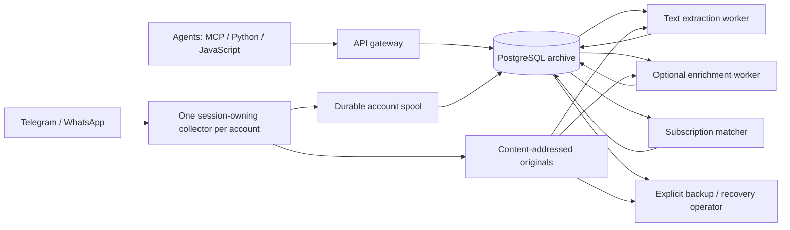

# Architecture and verification boundaries

AnyMsg is one repository and a shared PostgreSQL archive, with independently
invoked workers and two HTTP client packages. Logical components describe
responsibility and verification boundaries. They are not a promise of one
container, package or database per component.

## Logical components

These names also identify the product components in Tiden. Paths are relative
to this repository; a source anchor identifies an implementation location,
not proof that its behavior has been tested.

| Component | Responsibility and principal sources | Verification boundary |
| --- | --- | --- |
| Gateway & Access | `app.py`, `policy.py`, `commands.py`, `outgoing.py`, `messenger_operations.py`, `formatting.py`, `presentation.py`, gateway SQL role | REST/MCP contracts, authorization, redaction, typed arguments, preview and mutation fences |
| Archive & Search | `archive.py`, `envelope.py`, `spool.py`, `collector_state.py`, query/evidence modules, `people.py`, `reviews.py`, `receipts.py`, `reply_state.py`, `history_plan.py` | Transactions, revisions, conflicts, scope, cursors, coverage and explainable reply hints |
| Telegram Connector | `telegram_collector.py`, pairing, governor, identity, receipts and operations modules | Synthetic Telethon adapters, durable cursors, FloodWait, session/lease fences and native-operation outcomes |
| WhatsApp Connector | `whatsapp_collector.py`, pairing/identity modules, `whatsapp/` | Synthetic provider/IPC tests, command lanes, history bounds, identity evidence, passive receipts and media handling |
| Media Storage & Index | `blobs.py`, `storage_admission.py`, `file_extract.py`, `file_index.py` | Original integrity, scoped retrieval, extraction safety, passages, provenance, derivative invalidation and reuse |
| AI Enrichment | `enrichment.py`, `enrichment_providers.py`, `codex_enrichment.py`, `resource_admission.py` | Budgets, isolated processing, profile validation, result fences and untrusted model output |
| Subscriptions & Events | `subscriptions.py`, `subscription_worker.py`, `processing_events.py`, subscription SQL role | Key ownership, committed frontier, lifecycle/version checks, fair matching, atomic checkpointing and artifact references |
| Backup & Recovery | `backup.py`, crypto, runner, worker, receiver and recovery modules | Consistent table/blob manifests, encrypted transfer, restore equality, quarantine and retention anchors |
| Deployment & Verification | SQL migrations, `Dockerfile`, Compose overlays, `.github/`, `scripts/`, `telemetry.py` | Schema checksums, least privilege, images/packages, synthetic network drills and authentic CI evidence |
| Python Client & Operator CLI | `anymsg/`, `messaging_service/__main__.py`, packaged assets | Safe HTTP client, token-file CLI, source assets and explicit owner administration |
| JavaScript Client | `packages/npm/` | Dependency-free HTTP client, local argument validation, TypeScript declarations and token-file CLI |

Unless otherwise specified, Python module names in the table are under
`messaging_service/`. `store.py` supplies shared transaction/authorization and
dispatch infrastructure; components may intentionally overlap there. The
operator entry point and schema migrations likewise cross domain boundaries.
Do not interpret a change in a shared file as coverage of every affected domain.

## Data flow and process boundaries

This diagram omits the reverse-proxy and database deployment details. Sending
and native operations are authorized and persisted by the gateway, then claimed
by the existing account collector; they do not start a second provider client.
Original, extracted-text and model-result readiness are separate states and
events. Subscription inspection reads committed matches without provider polling
or acknowledging another agent's work.

## Implemented behavior versus planned work

The maintained specs describe behavior present in the development source,
including experimental features. `Active` means a maintained implementation
contract; it does not mean every clause is verified or that all optional workers
are enabled in an installation. Registry versions can lag development; consult
the version notes in [README.md](README.md).

Examples of boundaries that must stay explicit:

- `get_file_segments` paginates timestamped audio transcription segments.
  `search_files` returns matched document passages; `get_file_text` reads text
  and document source spans. There is no query argument to `get_file_segments`.
- `history-plan` previews a recent-first plan. Durable multi-wave execution is
  planned; a successful preview does not prove provider history was downloaded.
- Subscriptions are durable and passive. Host wake-up/push delivery and event ACK
  are planned; a new MCP result alone cannot activate an idle agent.
- Owner-read observations, recipient delivery/read receipts and a credential's
  local reply dismissal are different evidence. Passive reads do not send a
  provider read receipt.
- Original deduplication and context-bound derivative reuse are implemented.
  Cold-original eviction/rehydration and independent AI artifact reuse remain
  planned. An unavailable original is not a download guarantee.
- Container defaults describe the deployment template. Synthetic tests do not
  prove current provider completeness, transcription quality, server capacity
  or health of an off-site backup receiver.

Future behavior belongs in [ROADMAP.md](ROADMAP.md) or an explicitly scoped
change intent. It must not silently become an implemented baseline spec during
a repository scan.

## Evidence and reconciliation

Each spec keeps its stable identity and historical sources. Correct an inaccurate
claim by adding the reviewed source revision and updating the contract; do not
erase its history or rename a test to make a result appear applicable.

Test links require an assertion review against the relevant acceptance criteria.
Record which behavior the test establishes and what it does not establish.
A test can cover one clause without proving an entire broad feature. Split
independent requirements when needed rather than attaching every test in a
directory to a broad parent. Coverage gaps stay visible until evidence exists.

CI records authentic source identities, outcomes and the tested checkout SHA.
Tiden's workflow status and its verification status are separate: a maintained
`Active` spec can still have `no_test`, `not_run` or a failed test. Follow
[TIDEN-CI.md](TIDEN-CI.md) for branch mapping and evidence association.
