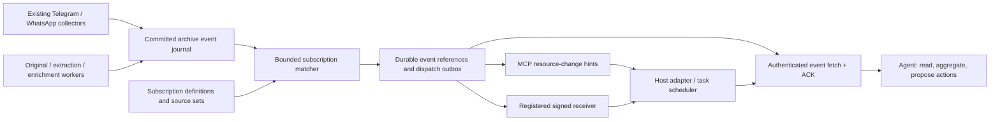

# Durable subscriptions and agent delivery

Current delivery work and priority: [BACKLOG.md](BACKLOG.md), DK-08–DK-10.
The planned sections below are design reference, not a separate delivery queue.

Status: **0.9.16 / schema 26 implements the general subscription core**:
explicit sources and senders, persistent lifecycle, committed-event matching and
passive event pages. The delivery architecture below also describes subsequent
work. Subscription ACKs, dispatch outbox, batching, notifications, host wake-up
and confirmed-send reply/mention presets are **not implemented** in this slice.
The JSON POST transport, existing archive ACKs and sending rules are unchanged.
Installing or upgrading does not create a subscription or activate a provider.

## Available API

The same five operations are MCP tools, `/v1/<operation>` POST endpoints and
Python/npm client methods:

| Operation | Arguments | Behavior |
| --- | --- | --- |
| `create_subscription` | `chat_ids`; optional `sender_ids`, `kinds`, `direction`, `origins`, `label`, `expires_at` | Freeze an authorized source set at the committed journal head |
| `list_subscriptions` | Optional `limit` (1–100) | List this exact credential's definitions; `has_more` is explicit |
| `get_subscription` | `subscription_id` | Inspect lifecycle, match frontier and gap evidence |
| `update_subscription` | `subscription_id`, current `version`, `action`; optional `resume_policy` | Pause, resume or close with optimistic concurrency |
| `get_subscription_events` | `subscription_id`; optional `after`, `limit` (1–100) | Read immutable event references; return `next_after`, without ACK |

Creation and lifecycle changes require **both `read` and `subscription-write`**
in the principal policy and credential ceiling. Inspection requires `read`.
Existing credentials do not inherit the new permission. A definition belongs to
its original key as well as its principal; a different key cannot adopt it.

`chat_ids` are archive IDs obtained from the scoped chat catalog, with 1–64
explicit sources. Optional senders are verified against selected chats and remain
account-scoped. An equal sender string observed in two accounts is ambiguous;
create separate subscriptions instead of treating it as one person. Sources are
immutable in this release: close and recreate to change filters. A label is
routing context, never authority to select a host task.

Defaults are `kinds=['message.created']`, `direction='incoming'`,
`origins=['live']`. An empty direction selects both directions. Explicit origins
can include `backfill`, `reconcile` or synthetic `fixture`; historical matches
are marked. Expiry is optional, timezone-aware, in the future and at most 366
days ahead. No messages before the creation frontier are replayed.

Lifecycle is `active`, `paused`, `closed`, `expired` or `access_changed`.
Resume defaults to `catch_up`; explicit `skip` records the intentionally skipped
journal range. Re-read the version after a `subscription_conflict`. Any principal
scope or credential-permission version change invalidates the original grant,
even if rights are later restored. Inaccessible definitions expose only a masked
ID/state/version, and must be recreated after checking the current scope.

Pages contain event/message/account/chat/sender/provider references, exact
revision, observation/provider time, origin and optional processing evidence.
They do not copy message bodies, transcripts or file bytes into subscriber
queues; use existing context/file tools to retrieve authorized content.
`after` is a caller-maintained position, **not a server ACK**. Passive reads do
not mark messages read in Telegram/WhatsApp or advance archive consumers.

`matcher_caught_up` means caught up to the **committed archive journal**. It does
not prove a provider/chat is current or its history complete; check scoped sync
status separately. A journal hole returns `journal_gap`; a full reference budget
returns `match_budget` and stops before the unrecorded event. Neither becomes a
successful empty complete result. Missing legacy revision identity evidence is
counted rather than guessed from a later edited message.

## Running the matcher

One small worker scans PostgreSQL; it opens no messenger sessions, calls no model
and mounts no originals. Its default pass handles at most 16 subscriptions and
200 journal events each, then waits two seconds. Matching references and each
checkpoint commit atomically; uniqueness and row locks support restart/retry and
multiple workers. Fair ordering rotates sources beyond one batch.

Install `messaging_service/subscription_role.sql` after migration 26, then create
a separate restricted LOGIN inheriting `messaging_subscriptions`. Put its DSN in
`deploy/private/subscriptions.dsn` (0600, readable by UID 10001). Never use the
owner or gateway DSN for this worker. Apply updated gateway, indexer and enrichment
role grants too: processing workers now publish their own readiness events.

For an operator-managed Compose checkout, follow [SETUP.md](SETUP.md), build the
runtime image from the current source and add `compose.subscriptions.yaml`:

```sh
cd deploy
docker compose -f compose.yaml -f compose.subscriptions.yaml build subscriptions
docker compose -f compose.yaml -f compose.subscriptions.yaml up -d subscriptions
```

A native equivalent is `python -m messaging_service.subscription_worker` with
`DATABASE_URL_FILE` pointing to that private DSN. `--once` supports bounded
operator diagnostics. This worker needs no public port. The optional overlay
limits memory to 256 MiB and has a read-only filesystem and internal DB network.

Operator bounds are `SUBSCRIPTION_MAX_DEFINITIONS` (default 64 per key, including
closed definitions; 1–1000) and `SUBSCRIPTION_MAX_MATCHES` (default 10,000 references
per subscription; 1–1,000,000). Set the match bound on the worker and the definition
bound on the API. Raising a match budget resumes retained events without provider
polling. This slice does not delete match rows or apply automatic journal
retention. Listing has no continuation cursor yet; keep the default definition
bound within one 100-item page or manage known IDs individually.

Schema-26 backups include definitions, source sets and matched references.
Quarantine restore closes definitions and advances versions, revokes credentials
and disables collectors, preserving source/match evidence without restarting
subscriptions against restored credentials.

## Product boundary

AnyMsg collects messenger data, selects relevant committed changes and delivers
recoverable event references. The consuming agent decides what those changes
mean: a news digest, a project update, a suggested task or a reply draft. Source
messages and generated descriptions remain evidence, not executable instructions.

A reply watch is a subscription preset. Sending is not a prerequisite for
subscribing to a chat, channel, set of chats or person's messages. A project name
can label a source set; this introduces no project/task management dependency.

| Use case | Selection | Delivery policy |
| --- | --- | --- |
| Follow a dialogue | One account/chat, incoming messages | Immediate hint with bounded debounce |
| Wait for a reply | Confirmed send reference plus explicit reply policy | Immediate hint, expiring watch |
| Follow news | Explicit channel/chat set | Batch hint after a time window or count threshold |
| Follow a work stream | Named set of explicit sources, optional senders | Batched or immediate |
| Follow a person | Verified account-scoped sender references in selected chats | Chosen by the subscriber |
| Follow file processing | Originals or derived artifacts linked to selected messages | Separate readiness events |

Immediate delivery means prompt dispatch eligibility, not a latency guarantee or
an unconditional model turn. Batch delivery groups references; it does not run a
summarizer in the core. A batch must flush at its maximum wait even under a
continuous message stream.

## Planned delivery architecture



Use the existing PostgreSQL journal and a small background matcher/dispatcher.
Do not add Kafka, a second messenger client, an LLM in the ingestion transaction,
or a separate database for this first implementation. This is a design choice,
not a capacity benchmark. PostgreSQL wake-up signals can reduce polling latency;
the durable journal remains the recovery source if a signal is lost.

## Reused foundation and remaining delivery work

The implementation preserves these boundaries:

- `Store.append_event` writes revision snapshots and advances `feed_counter` in
  the transaction. Its counter row lock serializes the publication frontier;
  preserve that property instead of substituting a sequence that can expose
  gaps from uncommitted transactions.
- `get_updates` filters accounts, chats, senders, event kinds, origin, direction
  and dates. Consumers bind their filters and use version-checked page ACKs.
- `events`, `consumers` and `deliveries` already exist. Agent-send provenance and
  provider receipt observations can supply a confirmed reply anchor.
- ACLs intersect principal permissions with a credential ceiling. The common
  authorization layer coordinates access with operator policy changes.
- Existing event kinds are `message.created`, `message.edited`,
  `message.deleted`, `message.status` and `attachment.ready`. Extraction,
  transcript and description readiness now have independent file event kinds.
- The transport does not currently deliver unsolicited resource updates or
  start an agent turn. A filtered archive consumer is not a push subscription.

Do not repurpose `consumers` or silently change old filter/ACK semantics. Reuse
the journal and common policy code with separate subscription state.

## Subscription contract

A server-generated subscription ID identifies one selection and one delivery
stream. Persist authenticated principal, originating credential ID and permission
versions; never take ownership from a client-supplied agent or task ID. A client
correlation label helps routing but is not authority to contact another task.

Persist the following separately:

1. **Source selection:** explicit account/chat references and optional verified
   account-scoped sender references. A named source set expands to those IDs.
2. **Event selection:** kinds, direction, historical-origin policy and an
   optional reply/mention predicate.
3. **Starting boundary:** atomically observed committed journal frontier,
   or an explicit bounded replay boundary.
4. **Delivery:** immediate or batch, debounce, maximum wait, bounded page size,
   registered receiver reference and task binding if configured.
5. **Lifecycle:** active, paused, expired, closed or access-changed; expiry and
   version-checked configuration. Definitions survive service restarts.

Sources are a frozen explicit set in the first version. A source-set edit creates
a new selection generation and defines whether newly added sources replay.
Discovery of a new chat must not silently expand scope. A future account-wide
subscription may explicitly include future chats, with a visible policy.
Person names/usernames are resolved at setup; do not merge people across accounts
by display name or assume a WhatsApp LID is a verified phone identity.

Start with structural filters. Add bounded PostgreSQL text predicates later,
reusing existing search semantics. Evaluate text against the event's revision,
not a later edited body. File-text matching needs its own extraction-ready event
and a visible processing frontier; an unfinished index cannot mean no match.
LLM relevance rules and semantic filters are a later optional processing layer.

## Reply and mention presets

Bind a reply anchor to a confirmed outgoing receipt belonging to the caller,
the same account/chat and its exact provider message reference. A failed or
uncertain send is not a confirmed anchor. Keep two meanings explicit:

- A new incoming private-chat message after the watch boundary is a dialogue
  update, even if it has no native reply reference.
- A native reply to the selected message is an explicit reply, where the
  provider actually supplied that reference.

Group policies can select native replies to the anchor, verified mentions of the
configured account owner, or all incoming messages. Unknown mention/reply
metadata stays unknown; textual name matching is not proof of a native mention.
Persist unresolved reference evidence so an out-of-order anchor can be matched
later without losing the event. Expiry and pause/replay boundaries still apply.
Receipts and status changes are selectable but do not count as a human reply.

## Event and file semantics

Implemented processing event kinds are `file.text.ready`,
`file.transcript.ready`, `file.description.ready` and `file.processing.failed`.
They refer to an attachment occurrence, exact message revision and versioned
artifact. Original availability remains the existing `attachment.ready` kind.

Message arrival must not wait for a download or model. Original-ready,
extracted-text-ready and derived-artifact-ready events are independent. An
artifact reused for an exact duplicate must still produce authorized occurrence
references where appropriate. Do not broadcast a blob hash or description to
other chats merely because they share the same file bytes.

Preserve event order separately from provider message time. Include event ID,
kind, exact revision, source references, provider timestamp when known,
archive observation time, origin and readiness basis. A late historical import
or reconciliation event must not masquerade as a fresh incoming message. A
processing completion for an older message is a new processing event, not a new
message. Live/catch-up classification must be tested against collector behavior.
Completion retries do not duplicate readiness. Obsolete/deleted occurrences do
not publish a new ready artifact. A formatting-only revision rebind may retain
an already-ready artifact without a new processing-completion event: the
`message.edited` event announces the revision, and file tools show retained
readiness. Exact duplicate parser reuse emits separate occurrence references.

Implemented and planned persistence:

| State | Purpose |
| --- | --- |
| Subscription + versioned source references | Definition, ownership, start and lifecycle |
| Matcher checkpoint | Last scanned committed frontier for each bounded partition |
| Subscription matches | References to journal events, unique by subscription generation/event |
| Delivery outbox | Due hint, retry/backoff, lease and target binding |
| Delivery receipts / progress | Issued page, authorized generation, ACK and expiry |
| Registered receiver | Operator-owned destination, signing key and permitted task bindings |

Avoid copying full message bodies into every subscriber queue. Match references,
checkpoint advancement and dispatch eligibility commit atomically. A matcher
crash before commit replays safely; after commit uniqueness prevents duplicate
logical matches. Inspect existing revision snapshots for historical predicates
instead of using mutable message fields without stating their semantics.

## Recovery, batching and bounded work

Use at-least-once delivery with stable IDs. Duplicate HTTP hints are expected.
A receiver deduplicates before scheduling a turn; an agent ACKs only after
durably recording or processing a page. A webhook HTTP success, MCP stream ACK,
task enqueue, model completion and archive/provider read state are different.

Within one task, overlapping subscriptions can share a wake-up hint while the
fetch result retains every matched subscription ID and reason. Do not conflate
that coalescing with deleting events. Different tasks have independent progress;
one task cannot ACK another task's issued page.

Paused subscriptions require an explicit resume policy: catch up or skip to a
new committed boundary. Default to bounded catch-up. Offline replay is bounded
by declared retention. If retention or a queue budget prevents full replay,
return a durable gap marker and recoverable boundary, never silently drop events
or report an empty complete result. Events that are still retained can be
rematched incrementally without provider polling.

Apply operator-tunable bounds to definitions, source references, pending rows,
bytes, batch size, dispatch rate, retry lifetime and per-task wake-up frequency.
Reserve scheduling capacity for dialogue replies while ensuring news batches
are not starved. Continuous traffic must not postpone the maximum batch flush.
Bulk matching/file processing must not occupy the existing provider sending
lane or hold a long-running ACL lock/stream database connection.

## Authorization and delivery security

The implemented opt-in `subscription-write` permission requires `read`.
A separate `subscription-ack` permission is proposed for the next consumption
block; it is not in the current permission catalog. Do not grant new permissions to
legacy credentials automatically. Operator policy remains the outer ceiling.

Recheck current credential validity, principal/key ceilings and source scope on
creation, every fetch/ACK, every dispatch and each stream notification. Stop
delivery after revocation or expiry. Invalidate old receipts after scope or
selection generation changes; restored permissions do not revive old grants.
Credential rotation requires an explicit validated transfer, not implicit
adoption by another key of the same principal.

Separate keys/principals establish security boundaries. Multiple task labels
sharing one key have routing and ACK separation but are not mutually isolated
security identities. A host's verified binding controls which actual task is
woken; an arbitrary task string supplied by an agent cannot select another
user's task. Mask inaccessible source names, counts and freshness diagnostics
after a scope reduction, including pending events and subscription metadata.

Webhook destinations are operator-registered, not agent-supplied arbitrary
URLs. Use HTTPS, signed bounded opaque hints, timestamp/replay protection,
key rotation, timeouts and backoff. Validate destinations and resolved addresses,
disallow redirects and private/link-local/metadata routes unless a particular
internal receiver is explicitly configured. An event reference is not a bearer
grant: the receiver fetches through its scoped credential. No message text,
tokens, presigned URLs or file bytes in delivery hints or diagnostic logs.

The first-party host adapter must also obey host authorization requirements;
receiving a messenger event grants neither permission to message another Codex
task nor permission to send a Telegram/WhatsApp reply.

## MCP and host adapters

The durable application subscription is distinct from a live MCP notification
stream. For MCP 2026-07-28, an opted-in client uses `subscriptions/listen` with
authorized resource URIs; `notifications/resources/updated` is an invalidation
hint. The stream's acknowledged filter, cancellation, reconnect and bounded
lifetime must follow the negotiated protocol. Older clients need a separately
tested legacy adapter. Never advertise notification capability before delivery
is implemented and tested.

An illustrative resource URI is `anymsg://subscriptions/<opaque-id>/events`.
Re-read durable pending events after reconnect; the resource update alone is
not the event log. MCP resources are application-driven, so a host decides
whether an update refreshes UI/context or schedules a new model turn. A
registered webhook/task receiver is the fallback for a host without wake-up
support. Advertise independently: fetch, notification transport, host scheduling
and observed host-turn support. Do not claim Grok/Dot support from SDK schemas.

The five implemented tools are listed above, with strict schemas and REST/SDK
parity. Future `ack_subscription_events` and delivery configuration require their
own tested contract. Existing `get_updates` stays usable.

## Freshness and observability

Expose source collection frontier/gaps, subscription match frontier, pending
processing state and last delivery/ACK independently within the caller's scope.
Return whether the matcher is caught up, paused or blocked, and why. No events
with an offline collector cannot establish that a chat has no new messages.

Measure provider-time-to-observation where known, committed ingest-to-match,
match-to-dispatch, dispatch-to-host-enqueue and host-enqueue-to-model-start
separately. Provider timestamps are not always precise enough for a true
end-to-end latency. Host execution and file/model readiness must not be hidden
inside an undifferentiated MCP response-time figure.

## Delivery plan and acceptance

1. **Implemented general core:** explicit chat/channel sets and account-scoped
   senders, lifecycle, committed-event matching, passive pages and separate
   file/artifact readiness. Reply/mention presets remain future work; generic
   incoming filters do not establish that a message is a reply to a sent anchor.
2. **Scoped consumption and dispatch policy:** independent fetch/ACK,
   replay/gap reporting, immediate/batch, hard maximum flush, bounded outbox,
   fair scheduling and retry/leases. Recheck current rights at every boundary.
   A receiver simulator verifies duplicate hints and offline retry; it does
   not establish actual host-turn support.
3. **One actual host plus MCP transport:** verify supported wake-up mechanism,
   implement a signed registered receiver if needed, then opt-in delivery and
   measured reconnect/restart recovery. Support further hosts through adapters.
   Live messenger sends need separate exact approval.
4. **Later:** bounded text/file predicates, dynamically scoped future-source
   policies, optional semantic relevance and agent-generated digests. These are
   not prerequisites for dependable structural subscriptions.

Required synthetic checks: separate accounts/principals/keys; same key/two tasks;
unauthorized source/task binding; revoked/expired key during dispatch/stream;
scope reduction and rotation; duplicate/out-of-order events; concurrent commits;
reply versus unrelated group message; historical import versus live/catch-up;
message/original/transcript stages; duplicate artifact occurrences; edited/deleted
revision predicates; cold-file unavailability; overlapping subscriptions;
restart/lease recovery; pause/resume; pagination/ACK conflicts; queue and retention
gap; continuous batch traffic; maximum wait and fairness; signature/replay/SSRF
failures. Preserve full existing CI and backup/quarantine coverage when schema
tables, roles or API permissions change.

Keep the three original pilot categories: durable selection/events, scoped
fetch/ACK, and verified host delivery. Generalizing the first category must not
erase the security/recovery checks in the other two. This architecture document alone is not test evidence; implemented tests cover
the first category, while consumption/dispatch and actual host delivery remain
unimplemented.

## Primary protocol references

- [MCP resources and application-driven interaction](https://modelcontextprotocol.io/specification/2026-07-28/server/resources)
- [MCP notification subscriptions and cancellation](https://modelcontextprotocol.io/specification/2026-07-28/basic/patterns/subscriptions)
- Current implementation: `messaging_service/store.py`, `update_queries.py`,
  `policy.py`, `archive.py`, `receipts.py` and `app.py`; [ACCESS.md](ACCESS.md),
  [SENDING.md](SENDING.md) and [MESSAGE_ACTIONS.md](MESSAGE_ACTIONS.md).
